<div align="center">

# JobHunter OS

**The operations center for a serious job search.**

Capture every opportunity, see how well it fits your real profile, keep track of the people you
talk to, never miss a follow-up, and get honest numbers about what is working.


[Features](#features) · [Screenshots](#screenshots) · [Architecture](#architecture) ·
[Getting started](#getting-started) · [Specification](docs/spec/README.md)

</div>

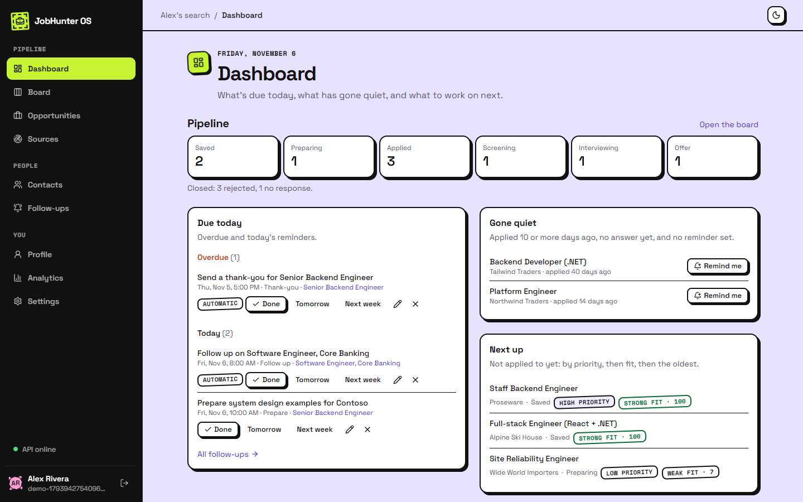

## Why

A job search runs across job boards, careers pages, a CV, recruiter conversations, reminders and a
spreadsheet nobody updates. Three things go wrong:

- **Opportunities get lost.** Nobody remembers which postings were applied to, when, or what
  happened next.
- **Effort goes to the wrong places.** Without comparing a posting to your real profile, time goes
  to poor fits while good ones wait.
- **Follow-ups don't happen.** A polite note a week after applying is the cheapest thing that
  improves response rates, and the first thing forgotten.

JobHunter OS keeps all of it in one place and does the bookkeeping, while you make every decision
that leaves the app.

## Features

| | Feature | What it does |
|-|---------|--------------|
| **F1** | Profile and evidence | Skills with level and years from a 128-entry catalog that folds aliases (`C#` = `csharp`), and the roles and projects that back each one up |
| **F2** | Opportunities | Capture a posting by hand, from pasted text, from a link, or from a company's public Greenhouse, Lever or Ashby board. Check what was read, then move it across a Kanban board with full stage history |
| **F3** | Smart matching | Requirements read from the posting (pattern rules, or Claude when configured) that you confirm, then a deterministic fit score that shows what's covered, partly covered and missing |
| **F4** | Recruiter CRM | The people in your search, linked to opportunities, with every conversation logged |
| **F5** | Follow-ups | Reminders that follow from what happened (applying adds one, a reply closes it), and email drafts you approve before they're sent through [Outreach Studio](https://github.com/GEKKOLAS/smtp) |
| **F6** | Analytics | Answer, interview and offer rates with their sample sizes, typical wait for an answer, week by week, by source and by target role, plus the skills postings ask for and your most frequent gaps |
| **F7** | Dashboard | What's due today, what has gone quiet, and what to work on next |

## Screenshots

Two themes, one app: **Mailroom** (light, ink borders and hard shadows) and **Nocturne** (dark,
hairline borders and a violet accent). The screenshots use a demo workspace; every company and
person in them is made up.

### Board

Every opportunity from saved to offer, with its fit score on the card. Drag a card or use its Move
menu; only moves that make sense are offered, and every move is kept in the history.

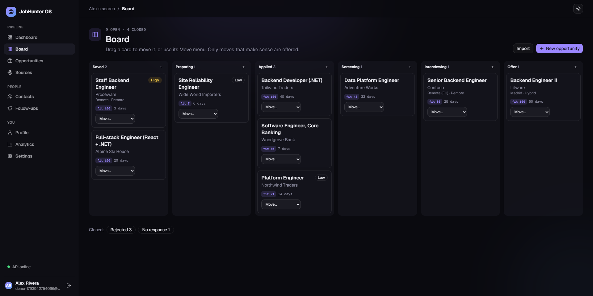

### Fit, with its reasons

An estimate from the requirements you confirmed, never from what a parser guessed. Each one says
what you have, what is only partly covered, and what is missing.

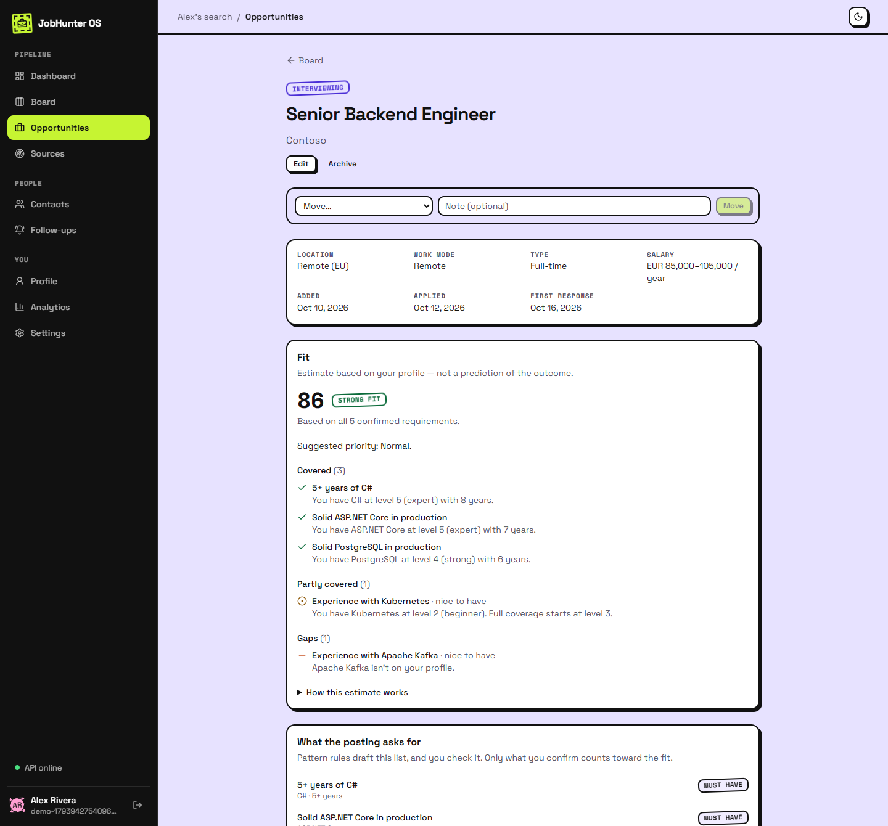

### Analytics that show their sample size

Every rate says what it came from ("6 of 10"), and under five applications it says "too few to say"
instead of a percentage. Weeks follow your time zone, and the chart has a table view.

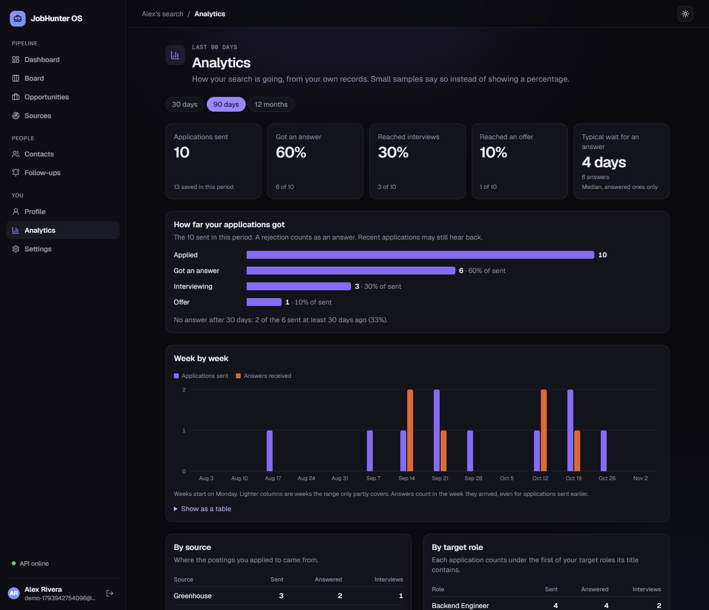

### Contacts and the conversations with them

The people in your search, what they're part of, and everything that was said. Logging their reply
records the first response on the application and closes its follow-up reminder.

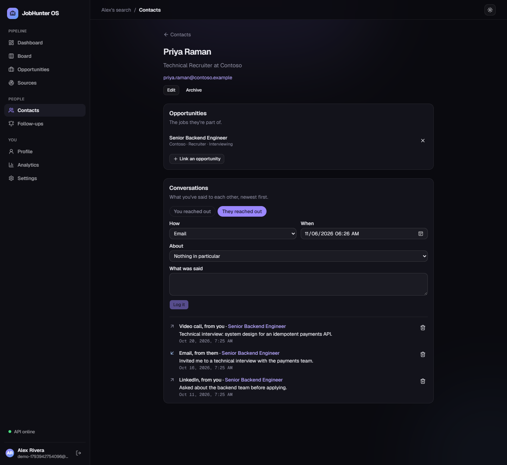

### And the rest

<table>
  <tr>
    <td width="50%">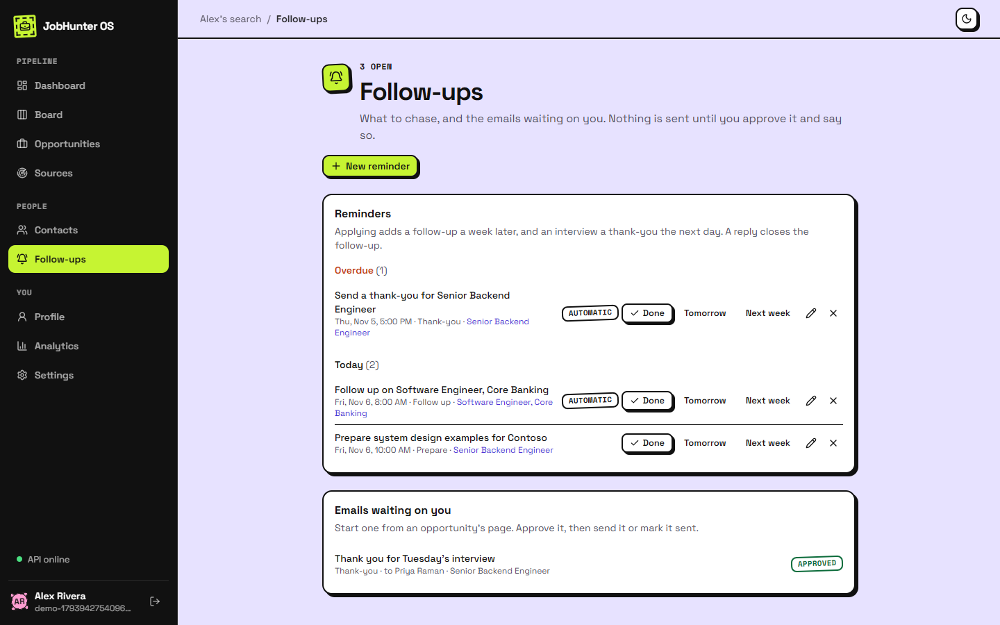</td>
    <td width="50%">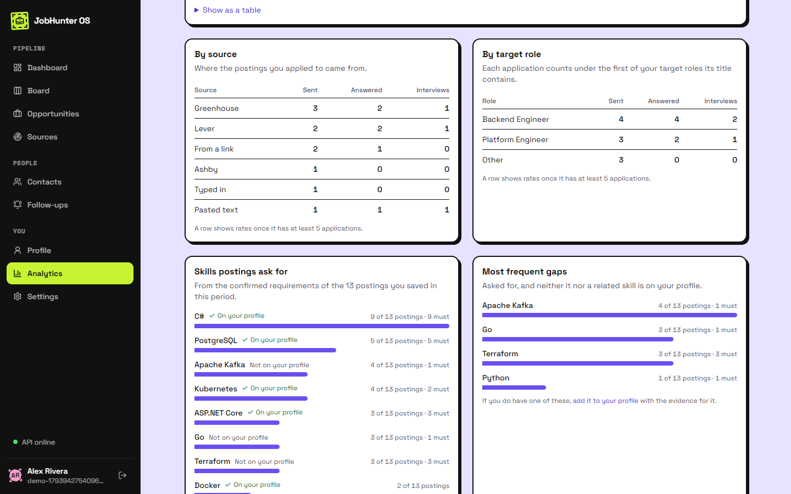</td>
  </tr>
  <tr>
    <td align="center"><b>Follow-ups</b>: automatic and manual reminders; nothing is sent until you approve it</td>
    <td align="center"><b>Skills and gaps</b>: what postings ask for, and what your profile lacks</td>
  </tr>
  <tr>
    <td width="50%">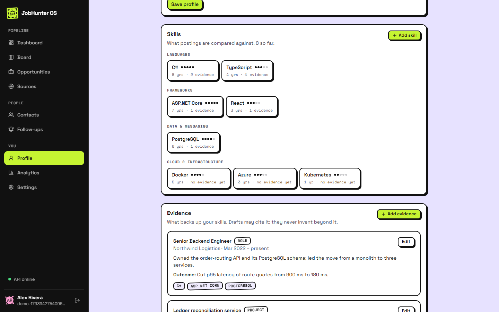</td>
    <td width="50%">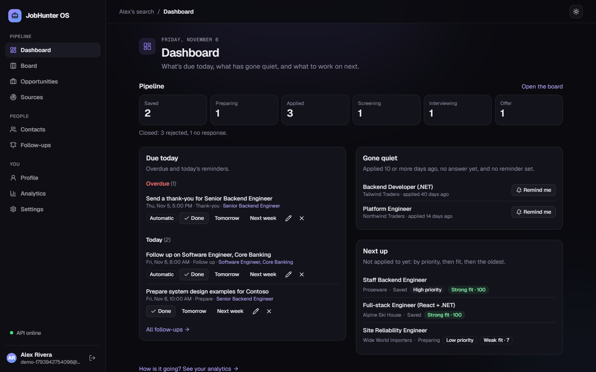</td>
  </tr>
  <tr>
    <td align="center"><b>Profile</b>: skills with the evidence behind them; "no evidence yet" is a nudge, not an error</td>
    <td align="center"><b>Dashboard</b> in the Nocturne theme</td>
  </tr>
</table>

<p align="center">
  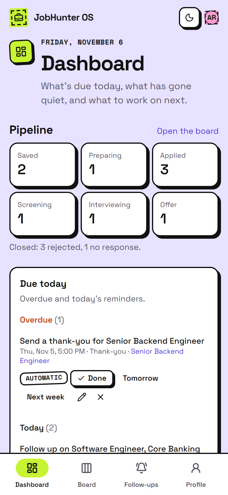
  &nbsp;&nbsp;
  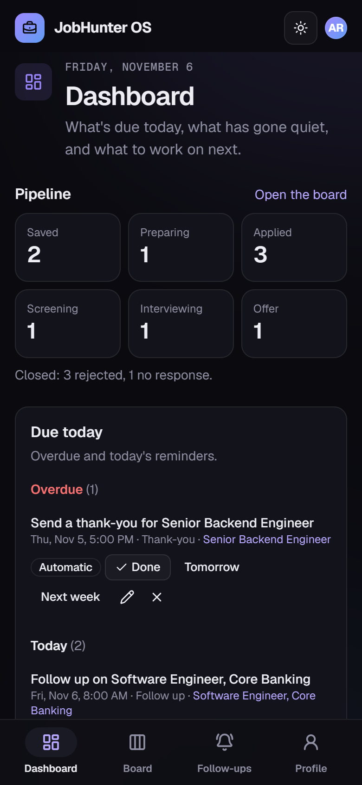
  <br>
  <sub>Built for phones too: a tab bar for what you do on the move, every other area one tap away.</sub>
</p>

## Principles

1. **Honest numbers.** Fit scores are estimates with their reasons, never a probability of being
   hired. Rates show their sample size, and small samples say so.
2. **Evidence, not invention.** AI may read, summarize and draft. It may not add skills, numbers or
   achievements your profile doesn't contain, and its drafts are checked before you see them.
3. **Human approval for anything outward.** Nothing is sent without an explicit click on that
   specific email.
4. **Authorized sources only.** Postings come from you or from the public job-board APIs companies
   publish for this. Sites whose terms forbid automated reading are refused, with a suggestion to
   paste the posting instead.
5. **Quality over volume.** There is no "apply to 50 jobs" button.

The full reasoning is in the [product requirements](docs/spec/01-prd.md).

## Architecture

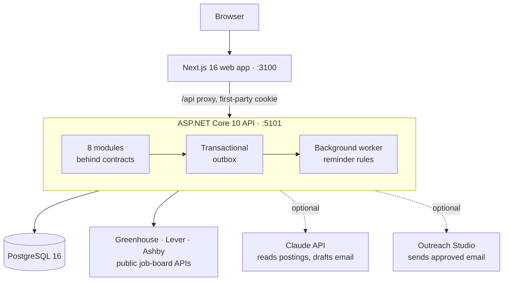

A **modular monolith** with Clean Architecture layers. The modules (Identity, Profile,
Opportunities, Matching, Contacts, FollowUps, Analytics, Integrations) talk to each other only
through published contracts and domain events. Architecture tests fail the build when a module
reaches into another one.

| Layer | Stack |
|-------|-------|
| API | ASP.NET Core 10, EF Core 10 with Npgsql, FluentValidation, Serilog, OpenTelemetry |
| Web | Next.js 16, React 19, TypeScript, Tailwind CSS 4, shadcn/ui, TanStack Query, Zod |
| AI | The official Anthropic SDK, behind ports with deterministic fallbacks |
| Tests | xUnit, Testcontainers (real PostgreSQL), NetArchTest, Vitest; Playwright for the screenshots |

### Engineering highlights

- **Transactional outbox with idempotent handlers.** Events are written in the same transaction as
  the change that raised them. A worker claims them with `FOR UPDATE SKIP LOCKED`, retries with
  backoff, and parks a message after 10 attempts, which turns the health check Degraded. Inbox
  receipts make a redelivered message a no-op.
- **SSRF-safe imports.** Links are checked before the request, every resolved address is checked
  again at connect time (which closes DNS rebinding), and redirects are followed by hand and
  re-checked.
- **Deterministic, explainable matching.** The fit score is plain code with an exhaustive unit
  suite, recomputed on every read, so a deleted skill or a stage move can never leave a stale
  number behind.
- **AI with guardrails.** Claude reads postings and writes drafts only through ports. Its output is
  validated against a schema, and a draft that adds any number, date, skill or company you didn't
  provide is thrown away, never "repaired". Without a key, pattern rules do the reading.
- **Secrets done properly.** Outreach Studio keys are stored with AES-256-GCM envelope encryption
  (a data key per row, wrapped by a versioned key, the row id as associated data). Only the last
  four characters are ever shown back.
- **Security basics, all of them.** Cookie sessions you can see and revoke, Argon2id password
  hashes, double-submit CSRF tokens, rate limits, security headers, ownership checks that answer
  404 rather than 403, and an audit log of every state change.
- **Honest analytics.** Every metric is a pure function with its own unit test, behind a read-only
  database port. Rates are withheld under five, and chart colors are checked for color-blind
  safety in both themes.

The design is written down before the code:
[architecture](docs/spec/02-architecture.md) · [domain and API](docs/spec/03-domain-and-api.md) ·
[implementation plan](docs/spec/04-implementation-plan.md).

## Getting started

You need the .NET 10 SDK, Node.js 22 or later, and Docker.

Start PostgreSQL (it listens on 5433, so it can run next to other local databases):

```bash
docker compose up -d postgres
```

Run the API on http://localhost:5101. It applies migrations on startup in development:

```bash
dotnet run --project src/JobHunter.Api --launch-profile http
```

Install the web app's packages:

```bash
npm --prefix web install
```

Run the web app, then open http://localhost:3100 and create an account:

```bash
npm --prefix web run dev
```

### Optional: Claude

Everything works without an API key; pattern rules read the postings. To have Claude read them and
write first drafts, add a key to the API's user secrets (never to a file in the repository):

```bash
dotnet user-secrets set "Ai:ApiKey" "your-anthropic-key" --project src/JobHunter.Api
```

### Optional: sending through Outreach Studio

Without it, an approved draft is copied and you mark it sent. To send from the app, run
[Outreach Studio](https://github.com/GEKKOLAS/smtp) on http://localhost:5001 and create an API key
there. Then, in **Settings → Outreach Studio**, enter that key and the id of a template version whose
subject is `{{subject}}` and whose body shows `{{body}}`. Email goes out from your default mailbox
there.

### Secrets at rest

Development uses the key in `appsettings.Development.json`. The API refuses to start with that key
anywhere else; set `Secrets:Keys:1` (32 random bytes, base64) and `Secrets:ActiveVersion` instead.

## Tests

| Suite | Count | What it covers |
|-------|------:|----------------|
| Unit | 530 | Stage machine (every stage pair), fit scoring, skill catalog, SSRF guard, parsers, guardrails, every analytics definition |
| Integration | 133 | Every endpoint against a real PostgreSQL container: ownership isolation, outbox delivery, rate limits, CSRF |
| Architecture | 12 | Layer rules and module boundaries |
| Web | 75 | Pure logic and key components |

Run the .NET suites (integration tests need Docker running):

```bash
dotnet test JobHunter.slnx
```

Run the web suite:

```bash
npm --prefix web test
```

The screenshots above come from a script that builds a demo workspace and captures every page in
both themes, so they can be regenerated after a UI change. With the stack running and the web app
served from a production build (`npx next start -p 3101`):

```bash
npm --prefix web run screenshots
```

## Project structure

```
src/
  JobHunter.Domain/          entities, stage rules, fit algorithm, domain events
  JobHunter.Application/     use cases per module, ports, contracts between modules
  JobHunter.Infrastructure/  EF Core, outbox and worker, AI and HTTP clients, encryption
  JobHunter.Api/             controllers, auth, middleware, composition root
tests/
  JobHunter.UnitTests/  JobHunter.IntegrationTests/  JobHunter.ArchitectureTests/
web/                         Next.js app (src/app, components, lib) and the screenshot script
docs/spec/                   PRD, architecture, domain and API, implementation plan
```

## Status

Phases 0 to 8 are built and verified: every feature above works end to end. Phase 9, the launch
(container images, production configuration, deployment, and a case study), is in progress. See
the [implementation plan](docs/spec/04-implementation-plan.md).

## Part of a career toolkit

JobHunter OS is the second piece of a larger set of tools for a job search. The first,
**Outreach Studio** ([Mail Template Hub](https://github.com/GEKKOLAS/smtp)), designs and sends email
through your own Gmail or Outlook. JobHunter OS calls its API to send follow-ups, and only after you
approve each one.
